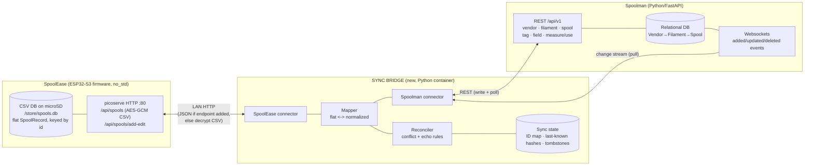

# Architecture

## System context



**Key property:** all sync logic and state live in the **bridge**. Spoolman is a pure API
client target (0 changes). SpoolEase is read/written over HTTP (0 changes if the bridge
decrypts; ~2 small routes if you want clean JSON).

## Capability inventory (what each side already gives us)

| Capability | Spoolman | SpoolEase |
|---|---|---|
| Read all records | `GET /spool`, `/filament`, `/vendor` (paged) | `GET /api/spools` → **AES-GCM-encrypted CSV** (whole DB) |
| Create/update | `POST`/`PATCH` on each | `POST /api/spools/add-edit` (encrypted) |
| Weight update | `PUT /spool/{id}/measure` (gross), `/use` (delta) | writes land in `weight_current` / `consumed_since_*` |
| Delete | `DELETE /spool/{id}` | `POST /api/spools/delete` |
| Tag (RFID) lookup/link | `GET /spool?tag=<uid>`, `POST /spool/{id}/tag` | `tag_id` field + in-RAM `tag_id → id` index |
| Change notification (push) | **Websockets** (`added`/`updated`/`deleted`, full payload) | **none** (no push, no `updated_at`) |
| Idempotency hooks | `external_id` (vendor/filament), `extra{}` (all), unique Tag | record `id`, `tag_id` |
| Auth | **none** for non-browser client (no `Origin` header ⇒ trusted) | per-device 7-char key → PBKDF2 → AES-GCM on `/api/*` |

The asymmetry that shapes everything: **Spoolman can push changes (websockets) but
SpoolEase cannot** — so the SpoolEase→bridge direction must be a **polling reconciliation
loop**, while the Spoolman→bridge direction can be **event-driven**.

## Bridge internal components

| Component | Responsibility |
|---|---|
| **SpoolEase connector** | Read all `SpoolRecord`s; write create/update/delete. Hides whether it decrypts the blob or calls a JSON endpoint. |
| **Spoolman connector** | REST client for vendor/filament/spool/tag/field/measure; websocket subscriber for the change stream. No auth header, no `Origin`. |
| **Mapper** | Pure functions: `SpoolRecord → (Vendor, Filament, Spool)` and back. Handles the 1:N fan-out, defaults (density/diameter), color/material conventions. |
| **Reconciler** | Decides per change: apply, skip (echo), or flag (conflict). Applies field-level ownership + last-writer-wins within a field's owner. |
| **Sync state store** | SQLite file (bridge-local). Tables: `id_map`, `shadow` (last-known serialized state + hash per side), `tombstones`. Survives restarts; the *only* place sync bookkeeping lives. |

## Deployment topology

Recommended: a small container beside Spoolman.

```yaml
# docker-compose.yml (sketch)
services:
  spoolman:
    image: ghcr.io/donkie/spoolman:latest
    # UNCHANGED
  sync-bridge:
    build: ./sync-tool
    environment:
      SPOOLMAN_URL: http://spoolman:8000/api/v1
      SPOOLEASE_URL: http://<device-ip>:80
      SPOOLEASE_SECURITY_KEY: <7-char>   # only if decrypting the blob
      SYNC_INTERVAL_SECONDS: "30"
    volumes:
      - ./sync-tool/state:/state          # the sync-state SQLite lives here
```

The bridge reaches Spoolman over the compose network and SpoolEase over the LAN. It holds
no secrets of its own beyond the optional SpoolEase key.

## SpoolEase interface — two options

**Option A — zero firmware change (decrypt the existing blob).**
The bridge reimplements `derive_key(securityKey, "example_salt")` (PBKDF2, 10000 iters,
SHA-256) + AES-GCM decrypt, then parses the `SpoolRecord` CSV from `GET /api/spools`.
Writes go to `POST /api/spools/add-edit` with the same encryption. Works today, but
couples the bridge to SpoolEase's internal CSV schema and crypto.

**Option B — add ~2 small routes (recommended).**
In `web_app.rs`, mirror the existing handlers but return/accept **JSON**, token-gated
(shared secret in a header), reusing `store.query_spools()` and `edit_spool_from_web`:

- `GET /api/spools.json` → `[{SpoolRecord...}]`
- `POST /api/spools.json` → create/update one record

This removes the crypto coupling; the contract becomes a stable JSON document. Everything
else in the bridge is identical.

## Spoolman interface — zero change

The bridge uses only the public REST API + websockets:

- **Read/poll:** `GET /vendor|/filament|/spool` with `external_id` / `tag` / `extra.<k>`
  filters and `limit`/`offset` paging (`x-total-count` header).
- **Write:** `POST`/`PATCH`/`DELETE`; `POST /spool/{id}/tag`; `PUT /spool/{id}/measure|use`;
  `POST /field/spool/{key}` once to register the `spoolease_id` extra field.
- **Events:** subscribe a websocket to `/api/v1/spool` (and `/filament`, `/vendor`) for the
  `added`/`updated`/`deleted` stream — this drives the Spoolman→SpoolEase direction without
  polling.

See [data-flow.md](data-flow.md) for the loops and [data-mapping.md](data-mapping.md) for
the field translation.
