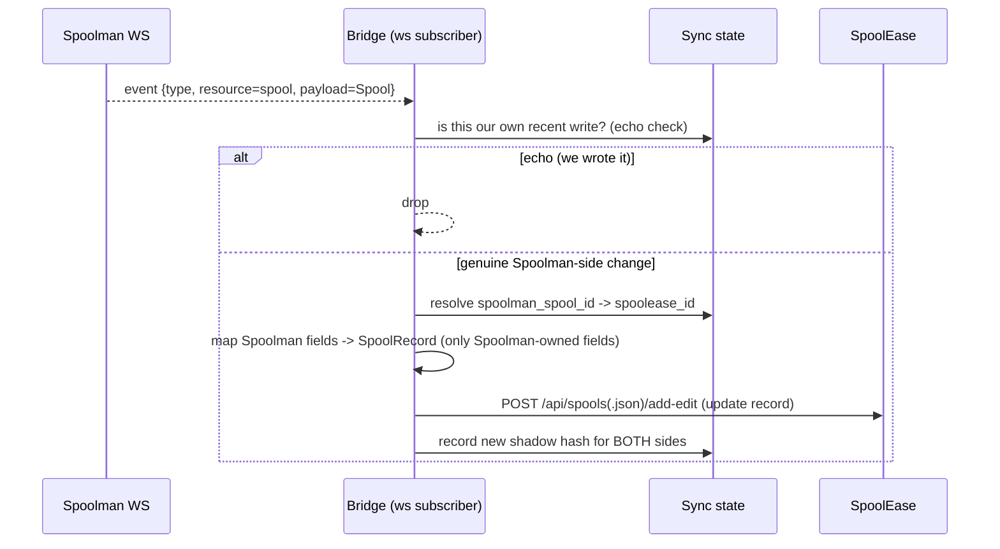

# Data Flow

How changes move in each direction, how they're detected, and how loops/conflicts are
avoided.

## Identity & idempotency keys

The bridge never guesses whether two records are "the same." It uses explicit keys and its
own `id_map` table.

| Entity | Primary match | Fallback match | Where stored |
|---|---|---|---|
| **Spool** | RFID **tag UID** → `GET /spool?tag=<uid>` | `extra.spoolease_id` → `GET /spool?extra.spoolease_id=<id>` | bridge `id_map`; Spoolman `extra` |
| **Filament** | `external_id` = SpoolEase base-filament code (e.g. `GFA01`) | synthesized `vendor\|material\|color_hex` | Spoolman `Filament.external_id` |
| **Vendor** | `external_id` or exact `name` | — | Spoolman `Vendor.external_id` |

The **tag UID is the ideal cross-system key**: both sides already carry it, and Spoolman
enforces it unique in its `Tag` table. For untagged spools, `extra.spoolease_id` is the
durable fallback. The bridge's `id_map` caches `(spoolease_id ↔ spoolman_spool_id)` so it
never has to re-resolve on the hot path.

One-time setup: `POST /field/spool/spoolease_id` to register the extra field (type `text`).

## Change detection

| Side | Mechanism | Why |
|---|---|---|
| **Spoolman → bridge** | **Websocket event stream** (`added`/`updated`/`deleted`, full entity payload) | Spoolman pushes; near-real-time, no polling |
| **SpoolEase → bridge** | **Polling reconciliation loop** every N seconds | SpoolEase has **no push and no `updated_at`** — only `added_time`/`encode_time` set at creation |

Because SpoolEase gives no modification timestamp, the bridge keeps a **shadow hash** of
each record's last-synced serialization. Each poll:

1. Fetch all `SpoolRecord`s (one `GET`, whole DB).
2. For each, compute a content hash; compare to `shadow`.
3. `new id` → create downstream. `hash changed` → update. `missing id` (was present) →
   delete/archive. `hash equal` → no-op.

This is a standard reconciliation loop; it's O(records) per cycle but the DB is small
(hundreds of spools) and the fetch is a single request.

## Direction 1 — SpoolEase → Spoolman (the primary direction)

```mermaid
sequenceDiagram
    participant SE as SpoolEase
    participant BR as Bridge (poll loop)
    participant ST as Sync state
    participant SM as Spoolman REST

    loop every N seconds
        BR->>SE: GET all SpoolRecords
        SE-->>BR: [record...]
        loop each record
            BR->>ST: lookup shadow hash
            alt new or changed
                BR->>BR: map flat -> (Vendor, Filament, Spool)
                BR->>SM: upsert Vendor (external_id/name)
                BR->>SM: upsert Filament (external_id; needs density/diameter)
                BR->>SM: upsert Spool (match by tag / extra.spoolease_id)
                opt has tag_id
                    BR->>SM: POST /spool/{id}/tag {uid=tag_id}
                end
                opt weight changed
                    BR->>SM: PATCH used_weight  (or PUT /spool/{id}/measure)
                end
                BR->>ST: write id_map + new shadow hash
            else unchanged
                BR-->>BR: skip
            end
        end
        BR->>ST: records gone from SE -> archive in Spoolman
    end
```

Upsert order matters: **Vendor → Filament → Spool** (Spool needs `filament_id`; Filament
needs `vendor_id`). Weight is applied last. See [data-mapping.md](data-mapping.md) for the
exact field translation and the density/diameter gap.

## Direction 2 — Spoolman → SpoolEase (write-back of Spoolman-owned fields)



Only **Spoolman-owned fields** (location, price, archived, comments, catalog enrichment)
are written back — see the ownership table in [data-mapping.md](data-mapping.md). Physical
weight is **never** written back to SpoolEase (SpoolEase owns it).

## Conflict resolution & echo suppression

Two-way sync's two failure modes — and how the bridge avoids each.

### Echo loops (A writes B, B's change comes back and overwrites A)

- The bridge records a **shadow hash per side** after every write it makes.
- Before applying an inbound change, it checks: does the incoming content already match the
  shadow it just wrote? If so, it's our own echo → **drop**.
- Optionally tag bridge-originated writes (e.g. a sentinel in `extra` or a short
  suppression window keyed by entity id + timestamp) for belt-and-suspenders.

### Genuine conflicts (both sides changed the same field between syncs)

Resolve by **field ownership first, then last-writer-wins within the owner**:

1. If the changed field is owned by the *other* side, the owner wins (the non-owner's edit
   is overwritten — and ideally surfaced in a log).
2. If both edited an owner-shared field, compare timestamps where available
   (Spoolman `last_used`/event `date`; SpoolEase `encode_time`/`added_time`) and take the
   later. With no reliable SpoolEase mod-time, **prefer the field's owner** as tiebreaker.

This keeps resolution deterministic without needing a true vector clock, which the systems
can't provide.

## Deletion & archival

- A SpoolEase record disappearing → **`archived=true`** on the Spoolman spool (not
  `DELETE`), preserving history and consumption records. Keep the `id_map` row with a
  tombstone.
- A Spoolman spool deleted → remove the `id_map` row; optionally delete on SpoolEase via
  `POST /api/spools/delete`. Default to **not** auto-deleting on the device (safer).

## Failure & resilience

- **Device offline:** the poll simply fails; the bridge keeps last shadow state and retries
  next cycle. Spoolman-side changes queue in the bridge until the device returns.
- **Partial write:** upserts are idempotent (keyed by tag/external_id/extra), so a retried
  cycle converges rather than duplicating.
- **Bridge restart:** all state is in the sync-state SQLite; it resumes from shadows, no
  full re-import needed.
