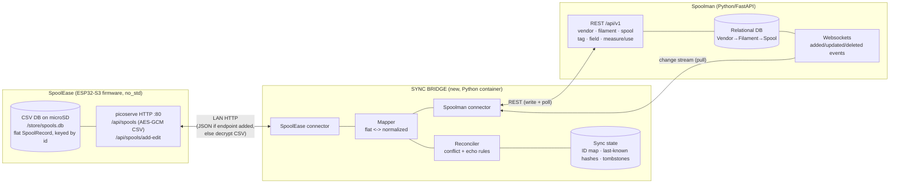
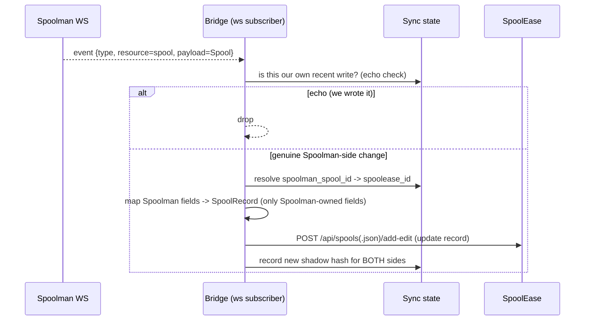

# SpoolEase ↔ Spoolman Sync — Design Document

Design documentation for keeping filament **type/details** and **weight** data in sync
between **SpoolEase** (ESP32-S3 firmware, flat CSV DB on SD card) and **Spoolman**
(Python/FastAPI inventory service, normalized relational DB).

Goal: **two-way sync** with the least intrusion into either product.

---

## Table of Contents

1. [Chosen Approach](#chosen-approach)
2. [Architecture](#architecture)
3. [Data Flow](#data-flow)
4. [Data Mapping](#data-mapping)
5. [SpoolEase JSON Endpoint Design](#spoolease-json-endpoint-design)
6. [Reference: Spoolman API](#referencespoolman-api)
7. [Reference: SpoolEase Internals](#referencespoolease-internals)

---

## Chosen Approach

**External bridge** (a standalone Python service next to Spoolman) + a small, optional JSON
endpoint on SpoolEase. Spoolman is unchanged. This keeps all mapping/conflict/bookkeeping in
the one component that's easy to iterate, matches the preferred topology, and is the least
total change. See [Decision](#decision) below for why a product modification *alone* can't
deliver robust two-way sync.

---

## Architecture

### System Context



**Key property:** all sync logic and state live in the **bridge**. Spoolman is a pure API
client target (0 changes). SpoolEase is read/written over HTTP (0 changes if the bridge
decrypts; ~2 small routes if you want clean JSON).

### Capability Inventory

| Capability | Spoolman | SpoolEase |
|---|---|---|
| Read all records | `GET /spool`, `/filament`, `/vendor` (paged) | `GET /api/spools` → **AES-GCM-encrypted CSV** (whole DB) |
| Create/update | `POST`/`PATCH` on each | `POST /api/spools/add-edit` (encrypted) |
| Weight update | `PUT /spool/{id}/measure` (gross), `/use` (delta) | writes land in `weight_current` / `consumed_since_*` |
| Delete | `DELETE /spool/{id}` | `POST /api/spools/delete` |
| Tag (RFID) lookup/link | `GET /spool?tag=<uid>`, `POST /spool/{id}/tag` | `tag_id` field + in-RAM `tag_id → id` index |
| Change notification (push) | **Websockets** (`added`/`updated`/`deleted`, full payload) | **none** (no push, no `updated_at`) |
| Idempotency hooks | `external_id` (vendor/filament), `extra{}` (all), unique Tag | record `id`, `tag_id` |
| Auth | **none** for non-browser client (no `Origin` header ⇒ trusted) | per-device 7-char key → PBKDF2 → AES-GCM on `/api/*` |

The asymmetry that shapes everything: **Spoolman can push changes (websockets) but
SpoolEase cannot** — so the SpoolEase→bridge direction must be a **polling reconciliation
loop**, while the Spoolman→bridge direction can be **event-driven**.

### Bridge Internal Components

| Component | Responsibility |
|---|---|
| **SpoolEase connector** | Read all `SpoolRecord`s; write create/update/delete. Hides whether it decrypts the blob or calls a JSON endpoint. |
| **Spoolman connector** | REST client for vendor/filament/spool/tag/field/measure; websocket subscriber for the change stream. No auth header, no `Origin`. |
| **Mapper** | Pure functions: `SpoolRecord → (Vendor, Filament, Spool)` and back. Handles the 1:N fan-out, defaults (density/diameter), color/material conventions. |
| **Reconciler** | Decides per change: apply, skip (echo), or flag (conflict). Applies field-level ownership + last-writer-wins within a field's owner. |
| **Sync state store** | SQLite file (bridge-local). Tables: `id_map`, `shadow` (last-known serialized state + hash per side), `tombstones`. Survives restarts; the *only* place sync bookkeeping lives. |

### Deployment Topology

Recommended: a small container beside Spoolman.

```yaml
# docker-compose.yml (sketch)
services:
  spoolman:
    image: ghcr.io/donkie/spoolman:latest
    # UNCHANGED
  sync-bridge:
    build: ./sync-tool
    environment:
      SPOOLMAN_URL: http://<spoolman_address>/api/v1
      SPOOLEASE_URL: http://<device-ip>:80
      SPOOLEASE_SECURITY_KEY: <7-char>   # only if decrypting the blob
      SYNC_INTERVAL_SECONDS: "30"
    volumes:
      - ./sync-tool/state:/state          # the sync-state SQLite lives here
```

The bridge reaches Spoolman over the compose network and SpoolEase over the LAN. It holds
no secrets of its own beyond the optional SpoolEase key.

### SpoolEase Interface — Two Options

**Option A — zero firmware change (decrypt the existing blob).**
The bridge reimplements `derive_key(securityKey, "example_salt")` (PBKDF2, 10000 iters,
SHA-256) + AES-GCM decrypt, then parses the `SpoolRecord` CSV from `GET /api/spools`.
Writes go to `POST /api/spools/add-edit` with the same encryption. Works today, but
couples the bridge to SpoolEase's internal CSV schema and crypto.

**Option B — add ~2 small routes (recommended).**
In `web_app.rs`, mirror the existing handlers but return/accept **JSON**, token-gated
(shared secret in a header), reusing `store.query_spools()` and `edit_spool_from_web`:

- `GET /api/spools.json` → `[{SpoolRecord...}]`
- `POST /api/spools.json` → create/update one record

This removes the crypto coupling; the contract becomes a stable JSON document. Everything
else in the bridge is identical.

### Spoolman Interface — Zero Change

The bridge uses only the public REST API + websockets:

- **Read/poll:** `GET /vendor|/filament|/spool` with `external_id` / `tag` / `extra.<k>`
  filters and `limit`/`offset` paging (`x-total-count` header).
- **Write:** `POST`/`PATCH`/`DELETE`; `POST /spool/{id}/tag`; `PUT /spool/{id}/measure|use`;
  `POST /field/spool/{key}` once to register the `spoolease_id` extra field.
- **Events:** subscribe a websocket to `/api/v1/spool` (and `/filament`, `/vendor`) for the
  `added`/`updated`/`deleted` stream — this drives the Spoolman→SpoolEase direction without
  polling.

---

## Data Flow

### Identity & Idempotency Keys

The bridge never guesses whether two records are "the same." It uses explicit keys and its
own `id_map` table.

| Entity | Primary match | Fallback match | Where stored |
|---|---|---|---|
| **Spool** | RFID **tag UID** → `GET /spool?tag=<uid>` | `extra.spoolease_id` → `GET /spool?extra.spoolease_id=<id>` | bridge `id_map`; Spoolman `extra` |
| **Filament** | `external_id` = SpoolEase base-filament code (e.g. `GFA01`) | synthesized `vendor\|material\|color_hex` | Spoolman `Filament.external_id` |
| **Vendor** | `external_id` or exact `name` | — | Spoolman `Vendor.external_id` |

The **tag UID is the ideal cross-system key**: both sides already carry it, and Spoolman
enforces it unique in its `Tag` table. For untagged spools, `extra.spoolease_id` is the
durable fallback. The bridge's `id_map` caches `(spoolease_id ↔ spoolman_spool_id)` so it
never has to re-resolve on the hot path.

One-time setup: `POST /field/spool/spoolease_id` to register the extra field (type `text`).

### Change Detection

| Side | Mechanism | Why |
|---|---|---|
| **Spoolman → bridge** | **Websocket event stream** (`added`/`updated`/`deleted`, full entity payload) | Spoolman pushes; near-real-time, no polling |
| **SpoolEase → bridge** | **Polling reconciliation loop** every N seconds | SpoolEase has **no push and no `updated_at`** — only `added_time`/`encode_time` set at creation |

Because SpoolEase gives no modification timestamp, the bridge keeps a **shadow hash** of
each record's last-synced serialization. Each poll:

1. Fetch all `SpoolRecord`s (one `GET`, whole DB).
2. For each, compute a content hash; compare to `shadow`.
3. `new id` → create downstream. `hash changed` → update. `missing id` (was present) →
   delete/archive. `hash equal` → no-op.

This is a standard reconciliation loop; it's O(records) per cycle but the DB is small
(hundreds of spools) and the fetch is a single request.

### Direction 1 — SpoolEase → Spoolman (the primary direction)

```mermaid
sequenceDiagram
    participant SE as SpoolEase
    participant BR as Bridge (poll loop)
    participant ST as Sync state
    participant SM as Spoolman REST

    loop every N seconds
        BR->>SE: GET all SpoolRecords
        SE-->>BR: [record...]
        loop each record
            BR->>ST: lookup shadow hash
            alt new or changed
                BR->>BR: map flat -> (Vendor, Filament, Spool)
                BR->>SM: upsert Vendor (external_id/name)
                BR->>SM: upsert Filament (external_id; needs density/diameter)
                BR->>SM: upsert Spool (match by tag / extra.spoolease_id)
                opt has tag_id
                    BR->>SM: POST /spool/{id}/tag {uid=tag_id}
                end
                opt weight changed
                    BR->>SM: PATCH used_weight  (or PUT /spool/{id}/measure)
                end
                BR->>ST: write id_map + new shadow hash
            else unchanged
                BR-->>BR: skip
            end
        end
        BR->>ST: records gone from SE -> archive in Spoolman
    end
```

Upsert order matters: **Vendor → Filament → Spool** (Spool needs `filament_id`; Filament
needs `vendor_id`). Weight is applied last. See [Data Mapping](#data-mapping) for the exact
field translation and the density/diameter gap.

### Direction 2 — Spoolman → SpoolEase (write-back of Spoolman-owned fields)



Only **Spoolman-owned fields** (location, price, archived, comments, catalog enrichment)
are written back — see the ownership table below. Physical weight is **never** written back
to SpoolEase (SpoolEase owns it).

### Conflict Resolution & Echo Suppression

Two-way sync's two failure modes — and how the bridge avoids each.

#### Echo Loops (A writes B, B's change comes back and overwrites A)

- The bridge records a **shadow hash per side** after every write it makes.
- Before applying an inbound change, it checks: does the incoming content already match the
  shadow it just wrote? If so, it's our own echo → **drop**.
- Optionally tag bridge-originated writes (e.g. a sentinel in `extra` or a short
  suppression window keyed by entity id + timestamp) for belt-and-suspenders.

#### Genuine Conflicts (both sides changed the same field between syncs)

Resolve by **field ownership first, then last-writer-wins within the owner**:

1. If the changed field is owned by the *other* side, the owner wins (the non-owner's edit
   is overwritten — and ideally surfaced in a log).
2. If both edited an owner-shared field, compare timestamps where available
   (Spoolman `last_used`/event `date`; SpoolEase `encode_time`/`added_time`) and take the
   later. With no reliable SpoolEase mod-time, **prefer the field's owner** as tiebreaker.

This keeps resolution deterministic without needing a true vector clock, which the systems
can't provide.

### Deletion & Archival

- A SpoolEase record disappearing → **`archived=true`** on the Spoolman spool (not
  `DELETE`), preserving history and consumption records. Keep the `id_map` row with a
  tombstone.
- A Spoolman spool deleted → remove the `id_map` row; optionally delete on SpoolEase via
  `POST /api/spools/delete`. Default to **not** auto-deleting on the device (safer).

### Failure & Resilience

- **Device offline:** the poll simply fails; the bridge keeps last shadow state and retries
  next cycle. Spoolman-side changes queue in the bridge until the device returns.
- **Partial write:** upsertes are idempotent (keyed by tag/external_id/extra), so a retried
  cycle converges rather than duplicating.
- **Bridge restart:** all state is in the sync-state SQLite; it resumes from shadows, no
  full re-import needed.

---

## Data Mapping

### The Granularity Mismatch (the crux)

SpoolEase stores **one flat row per physical spool**, cramming three concerns together:

```
SpoolRecord = { type/catalog } + { physical instance } + { Bambu calibration }
```

Spoolman **normalizes** the same information across three tables:

```
Vendor (brand)  ──<  Filament (a type/product)  ──<  Spool (a physical instance)
```

So the bridge must **fan out** on the way in and **collapse** on the way out:

- 10 SpoolEase rows of "Bambu PLA Basic Black" → **1** Vendor (Bambu) + **1** Filament
  (PLA Basic Black) + **10** Spools.
- A Spoolman-side rename of that one Filament → must propagate to **all 10** SpoolEase
  rows.

De-duplication of the Vendor/Filament level is therefore central — handled by the identity
keys in [Identity & Idempotency Keys](#identity--idempotency-keys).

### Field Mapping

#### SpoolRecord → Vendor

| SpoolEase | Spoolman `Vendor` | Notes |
|---|---|---|
| `brand` | `name` | `filament-brands.csv` hints a brand→manufacturer hierarchy; Spoolman Vendor is flat |
| (synthesized) | `external_id` | normalized brand slug, for idempotent match |
| `weight_core` (catalog) | `empty_spool_weight` | optional default tare for the brand |

#### SpoolRecord → Filament (the shared *type*)

| SpoolEase | Spoolman `Filament` | Notes |
|---|---|---|
| `material_type` (+ `material_subtype`) | `material` | convention decision: `PLA` vs `PLA Matte` — see open questions |
| `color_name` | `name` | or `"{material_subtype} {color_name}"` |
| `color_code` (RRGGBBAA) | `color_hex` | Spoolman accepts 6/8-hex, strips `#` — compatible |
| temps (`materials.csv` / `FilamentSupInfo`) | `settings_extruder_temp`, `settings_bed_temp` | |
| `weight_advertised` | `weight` (nominal full **net**) | |
| `weight_core` | `spool_weight` (tare) | catalog in `Spool-Core-Weights.csv` |
| `slicer_filament` (e.g. `GFA01`) | `external_id` and/or `article_number` | base-filament code; ideal Filament dedup key |
| — **not stored** | **`density`** (REQUIRED, >0) | **GAP** — resolve via Spoolman `GET /external/material` by material name |
| — **not stored** | **`diameter`** (REQUIRED, >0) | **GAP** — default `1.75` (SpoolEase is Bambu-centric) |

#### SpoolRecord → Spool (the physical *instance*)

| SpoolEase | Spoolman `Spool` | Notes |
|---|---|---|
| `id` | `extra.spoolease_id` | idempotency fallback key; register field once |
| `tag_id` | linked via `POST /spool/{id}/tag {uid}` | becomes the primary cross-system key |
| `weight_advertised` | `initial_weight` (net full) | nominal net weight of a full spool |
| `weight_core` (or `weight_new − weight_advertised`) | `spool_weight` (tare) | empty core/spool weight |
| computed net remaining (see below) | `remaining_weight` | Spoolman stores `used_weight = initial_weight − remaining_weight` |
| `consumed_since_add` / `consumed_since_weight` | folded into the net-remaining calc | print-tracked usage |
| `note` | `comment` | |
| `k_info` / `ext_has_k` (calibration) | `extra.spoolease_k` (JSON string) | Spoolman has no native K field |
| (device presence) | `archived` | record gone on SpoolEase → `archived=true` |

> Spoolman stores only `used_weight`; `remaining_weight`/lengths are **computed**
> (`remaining_weight = max(initial_weight − used_weight, 0)`). You send *either*
> `remaining_weight` *or* `used_weight` on write — never both.

### Source of Truth, Per Field

Ownership is **not** global — each field has a natural owner. Sync direction follows
ownership.

| Field group | Owner | Flows | Rationale |
|---|---|---|---|
| Spool existence, `weight_current`/consumption, `tag_id` binding, K calibration | **SpoolEase** | → Spoolman | SpoolEase has the scale, AMS/print telemetry, NFC reader |
| `material`, `color_hex`, `density`, `diameter`, temps (catalog identity) | **Spoolman** | ↔ (created from SpoolEase, enriched by Spoolman) | Spoolman has the richer catalog + external SpoolmanDB mirror |
| `location`, `price`, `archived`, `comment`, custom `extra` (inventory presentation) | **Spoolman** | → SpoolEase | Spoolman is the inventory hub |

Phase 1 can be **one-way SpoolEase → Spoolman** (mirror live spools). Phase 2 adds
write-back of the Spoolman-owned rows, governed by this table + echo suppression.

### Spoolman Endpoints Used, Per Operation

| Operation | Call |
|---|---|
| Find vendor | `GET /vendor?external_id=<slug>` or `?name=<brand>` |
| Create/update vendor | `POST /vendor` / `PATCH /vendor/{id}` |
| Find filament | `GET /filament?external_id=<code>` (or `?material=&color_hex=&vendor.id=`) |
| Create/update filament | `POST /filament` / `PATCH /filament/{id}` |
| Find spool | `GET /spool?tag=<uid>` → else `GET /spool?extra.spoolease_id=<id>` |
| Create/update spool | `POST /spool` / `PATCH /spool/{id}` |
| Link RFID tag | `POST /spool/{id}/tag {uid, format}` (409 if already linked elsewhere) |
| Apply weight (delta) | `PUT /spool/{id}/use {use_weight}` |
| Apply weight (gross scale) | `PUT /spool/{id}/measure {weight}` |
| Register extra field (once) | `POST /field/spool/spoolease_id {field_type:"text", ...}` |
| Resolve density default | `GET /external/material` → density by material |
| Subscribe to changes | websocket `/api/v1/spool` (+ `/filament`, `/vendor`) |

### Weight Semantics (RESOLVED)

Confirmed in `view_model.rs:1346-1357` (`weight_left_spool`):

```rust
let realtime_weight = (weight_current - weight_core) as f32 - consumed_since_weight;
// fallback when core unknown:
let realtime_weight = (weight_current - (weight_new - weight_advertised)) as f32 - consumed_since_weight;
```

- **`weight_current` = GROSS scale reading** (filament + core), not net remaining.
- **`weight_new` = GROSS at registration**; **`weight_advertised` = nominal NET full**;
  **`weight_core` = tare**. When core isn't known directly, `tare ≈ weight_new − weight_advertised`.
- **`consumed_since_weight`** = filament printed since the last weighing (reset to 0 on each
  weigh, `view_model.rs:1942`); **`consumed_since_add`** = printed since the spool was added.

**Bridge rule** — compute net remaining the same way SpoolEase does, then send it as
Spoolman `remaining_weight` (Spoolman derives `used_weight` itself):

```
tare       = weight_core  OR  (weight_new - weight_advertised)
if weight_current is not None:          # has been weighed
    remaining = weight_current - tare - consumed_since_weight
elif weight_advertised is not None:     # never weighed, track by print only
    remaining = weight_advertised - consumed_since_add
initial_weight (Spool) = weight_advertised      # net full
spool_weight  (Spool) = tare
```

This reproduces SpoolEase's own "weight left" exactly and sidesteps `/measure` vs `/use`
bookkeeping. (`PUT /spool/{id}/measure` with the raw gross `weight_current` is an
alternative, but then Spoolman — not SpoolEase — owns the net calc, which we don't want.)

### Open Questions (verify before building)

1. **Density/diameter defaults.** Confirm SpoolEase is 100% 1.75 mm, and wire density from
   Spoolman's `GET /external/material`.
2. **`material` convention.** `PLA` + subtype-in-name, vs. `PLA Matte` in `material`.
   Affects Filament dedup and ecosystem compatibility (Moonraker/slicer expectations).
3. **Deletion policy.** Confirm "SpoolEase record gone → Spoolman `archived=true`" (not
   `DELETE`) is the desired behavior to preserve history.
4. **Multi-color.** SpoolEase carries a single `color_code` per record; Spoolman supports
   `multi_color_hexes`. Confirm whether SpoolEase ever represents multi-color (via tags)
   and whether that needs mapping.
5. **Tag format value.** What `format` string to record on `POST /spool/{id}/tag`
   (`bambu` / `ntag` / `openprinttag`) based on SpoolEase's `tag_type` / `data_origin`.

---

## SpoolEase JSON Endpoint Design

This is the **one small product change** the external-bridge approach wants. It lets the
bridge read SpoolEase over plain JSON instead of reimplementing the device's AES-GCM web
encryption. Spoolman needs **no** change.

> **Scope:** phase 1 needs only the **read** endpoint. The **write** endpoint is for
> phase-2 two-way write-back; include it now or later.
>
> ⚠️ **This is a reviewed design + annotated Rust sketch, not a compiled patch.** SpoolEase
> is `no_std` ESP32-S3 firmware built against an external framework crate; it can't be
> compiled in this environment. Treat the code as a starting point to build & flash, not a
> drop-in diff.

### Why a new endpoint (and not the existing `/api/spools`)

`GET /api/spools` (`web_app.rs:258-269`) returns `store.query_spools()` — the whole DB as
CSV — **AES-GCM-encrypted** with a PBKDF2 key from the 7-char device security key. Two
problems for a sync tool: it must hold the key and reimplement the crypto, **and** the CSV
is serialized through `SpoolRecord`'s tag-encoding serde adapters (floats as base64, bools
as `"y"`/`"n"`), so it's awkward to parse. A dedicated JSON endpoint sidesteps both.

### The critical detail: serialize a plain DTO, not `SpoolRecord`

`SpoolRecord` carries `#[serde(serialize_with = "serialize_f32_base64")]` and
`serialize_bool_yn` (for the tag-URL encoding). If you `serde_json::to_string(&spool_record)`
directly, those adapters leak into the JSON. Define a **plain DTO** with normal types and
convert into it. This DTO *is* the bridge's contract (`bridge/spoolsync/models.py`).

### Change 1 — `core/src/store.rs`: add a JSON serializer next to `query_spools()`

`query_spools()` is at `store.rs:171-188`. Add a sibling:

```rust
use serde::Serialize;

// Plain-typed mirror of SpoolRecord for external JSON consumers. Normal number/bool
// serialization (unlike SpoolRecord, whose serde adapters base64 floats and y/n bools).
#[derive(Serialize)]
pub struct SpoolRecordJson {
    pub id: String,
    pub tag_id: String,
    pub material_type: String,
    pub material_subtype: String,
    pub color_name: String,
    pub color_code: String,
    pub note: String,
    pub brand: String,
    pub weight_advertised: Option<i32>,
    pub weight_core: Option<i32>,
    pub weight_new: Option<i32>,
    pub weight_current: Option<i32>,
    pub slicer_filament: String,
    pub added_time: Option<i32>,
    pub encode_time: Option<i32>,
    pub added_full: Option<bool>,
    pub consumed_since_add: f32,
    pub consumed_since_weight: f32,
    pub ext_has_k: bool,
    pub data_origin: String,
    pub tag_type: String,
}

impl From<&SpoolRecord> for SpoolRecordJson {
    fn from(r: &SpoolRecord) -> Self {
        Self {
            id: r.id.clone(), tag_id: r.tag_id.clone(),
            material_type: r.material_type.clone(), material_subtype: r.material_subtype.clone(),
            color_name: r.color_name.clone(), color_code: r.color_code.clone(),
            note: r.note.clone(), brand: r.brand.clone(),
            weight_advertised: r.weight_advertised, weight_core: r.weight_core,
            weight_new: r.weight_new, weight_current: r.weight_current,
            slicer_filament: r.slicer_filament.clone(),
            added_time: r.added_time, encode_time: r.encode_time, added_full: r.added_full,
            consumed_since_add: r.consumed_since_add, consumed_since_weight: r.consumed_since_weight,
            ext_has_k: r.ext_has_k, data_origin: r.data_origin.clone(), tag_type: r.tag_type.clone(),
        }
    }
}

impl Store {
    /// All spool records as a JSON array string (for the external sync endpoint).
    pub fn query_spools_json(&self) -> Option<String> {
        let spools_db = self.spools_db.get()?;
        let items: alloc::vec::Vec<SpoolRecordJson> =
            spools_db.records.borrow().values().map(|ri| SpoolRecordJson::from(&ri.data)).collect();
        serde_json::to_string(&items).ok()
    }
}
```

(`spools_db.records` is `pub` on `CsvDb`, `csvdb.rs:93`.)

### Change 2 — `core/src/app_config.rs`: add an integration token

Add a field to `AppConfig` (struct around `app_config.rs:101-116`) and load it from the
existing flash/TOML config path, exactly like the other settings:

```rust
pub integration_token: Option<String>,   // shared secret for /api/*.json endpoints
```

Expose it in `core/config/spoolease.cfg`:

```toml
[integration]
token = "choose-a-long-random-string"
```

### Change 3 — `core/src/web_app.rs`: the routes

Add alongside the other `router.route(...)` calls (near `/api/spools`, `web_app.rs:258`).
These do **not** use the `Encryption` extractor; they gate on the token instead. Check the
token from an `Authorization: Bearer <token>` header (or `?token=` query — whichever
picoserve extractor you wire up; confirm the exact API against the picoserve version in
`cargo.toml`).

```rust
// GET /api/spools.json  -> [ {SpoolRecordJson}, ... ]   (plain JSON, token-gated)
let router = router.route(
    "/api/spools.json",
    get(async move |state: State<ConsoleAppState>, /* token extractor */| {
        // if token != state.0.app_config.borrow().integration_token { return 401 }
        let body = state.0.store.query_spools_json().unwrap_or_else(|| "[]".to_string());
        picoserve::response::Response::new(StatusCode::OK, body)
            .with_header("content-type", "application/json")
    }),
);

// POST /api/spools.json  -> create/update one record   (PHASE 2 — two-way write-back)
// Accept a SpoolRecordJson, convert to SpoolRecord, and route through the SAME path the
// web UI uses so all invariants hold:
//   - new (empty id):            store.add_spool(rec, SpoolRecordExt::default())
//   - existing:                  store.edit_spool_from_web(rec)   (web_app.rs:293-374)
// Note edit_spool_from_web deliberately does NOT let the web change weight_new/weight_current
// (store.rs:295-296) — good, because SpoolEase owns physical weight; the bridge only writes
// Spoolman-owned fields (location/comment/etc.) back, matching the ownership table in
// data-mapping.md.
```

### Security

Both routes are token-gated and intended for the **LAN only** (the bridge runs next to
Spoolman). The token is a shared secret in `spoolease.cfg`; rotate it like a password. These
endpoints expose/accept the spool DB in plaintext JSON, so don't expose port 80 to the
internet (that was already true for the captive portal).

### Build & Verify

1. Set a token in `spoolease.cfg`.
2. Build/flash the console firmware (per SpoolEase docs; `espflash`, target
   `xtensa-esp32s3-none-elf`).
3. `curl -H "Authorization: Bearer <token>" http://<device-ip>/api/spools.json` → a JSON
   array of records.
4. Point the bridge at it: `SPOOLEASE_MODE=json`, `SPOOLEASE_TOKEN=<token>`.

### Upstreaming

This fits SpoolEase's "integrates with everything" design and is self-contained (one store
method + one config field + one or two routes), which makes it a reasonable PR. Frame it as
"optional JSON API for external integrations (e.g. Spoolman sync)," off unless a token is
configured.

---

## Decision: External Sync Tool vs. In-Product Modification

**Question:** For two-way sync, can a *minor modification* to SpoolEase or Spoolman do the
job, or do I need an external sync tool between them?

**Answer:** You need an **external sync tool** for the sync *engine*. The minor
modifications worth making are small, optional *affordances on SpoolEase* that make the
external tool cleaner — they are **not an alternative** to it.

### What two-way sync actually requires

Any robust bidirectional sync between two heterogeneous systems needs all of these:

1. **Bidirectional change capture** — detect what changed on each side.
2. **Model translation** — SpoolEase's one flat row ↔ Spoolman's 3 normalized tables
   (`Vendor → Filament → Spool`), a 1:N fan-out that must be reversed on the way back.
3. **Stable identity mapping** — remember that SpoolEase record `id=42` *is* Spoolman
   `spool_id=17`, across restarts.
4. **Conflict resolution + echo suppression** — decide who wins when both sides changed,
   and never re-apply a change you yourself just wrote (or you get infinite loops).
5. **Durable sync bookkeeping** — the ID map, the per-side *last-known state* (to diff
   against), and tombstones for deletes.
6. **Resilience** — retries, and tolerance for the device being offline.

### Why "modify one product" can't carry this alone

**Requirement #5 is the decisive one.** The sync bookkeeping is *third-party data that
belongs to neither system*:

- **Embed it in Spoolman** → you must add tables/columns to remember SpoolEase's shadow
  state and the ID map. That's schema pollution and a **maintained fork** that drifts from
  upstream Spoolman forever.
- **Embed it in SpoolEase** → you must store Spoolman's shadow state on the SD card and
  hold the ID map in RAM, on a constrained `no_std` ESP32-S3. Costly, and the mapping +
  conflict logic (requirements #2, #4) is exactly the kind of code you do **not** want to
  iterate on in firmware (reflash cycles, build toolchain).

An **external bridge owns a neutral third store** for all of this. That is precisely the
problem bridges exist to solve.

Two more factors push the same way:

- **Asymmetric models (#2).** Reversing the fan-out is non-trivial: a single filament
  rename on the Spoolman side must propagate to *many* SpoolEase records. This logic needs
  frequent tuning — put it where it's cheap to change (Python), not in firmware.
- **The device is intermittent.** SpoolEase is an appliance; it may be powered off or
  asleep. A bridge reconciles when it reappears. Two embedded peers trying to sync each
  other directly is fragile.

### The modification that *is* worth doing (and why it's minor)

SpoolEase already serves its whole DB at `GET /api/spools`, but **AES-GCM-encrypted** with
a key derived (PBKDF2) from the device's 7-char security key, as CSV. A bridge *can* read
that with zero firmware change by reimplementing the crypto and holding the key — but
that's brittle (couples to the internal CSV schema + crypto).

The clean alternative is **~2 small SpoolEase routes**, following the pattern already in
`web_app.rs`:

- `GET /api/spools.json` — token-gated, returns `store.query_spools()` as JSON (or just
  plaintext CSV). ~20–40 lines.
- `POST /api/spools.json` — token-gated write, reusing the existing `edit_spool_from_web`
  path, so the bridge can push Spoolman-owned fields back. Reuses existing logic.

These let the bridge speak clean JSON over the LAN instead of decrypting an internal blob.
**They assist the bridge; they don't replace it.** Spoolman needs **zero** changes in all
cases.

### Where the sync *engine* can live

| Host for the engine | Build effort | Two-way | Upstream-merge fit | Notes |
|---|---|---|---|---|
| **External bridge** + small SpoolEase endpoints | Low (Python) | Clean | Only the small SpoolEase endpoints get merged (welcome PR) | Keeps both cores generic; a separate process to run |
| **Inside Spoolman** (scheduled worker like `externaldb`) | Low (Python, direct DB) | Clean, in-process | Device-specific module — uncertain in Spoolman core | No extra process; one new module + 1 line in `main.py` |
| **Inside SpoolEase** firmware (full integration) | **High** (`no_std` HTTP client + mapper + Spoolman change-listener) | Heaviest | Most natural home, single maintainer | Flash/RAM budget; hardest to iterate |

All three still need the SpoolEase read/write interface (decrypt the blob, **or** the ~2
JSON endpoints). The endpoints are the recommended minimal change in every case.

### Recommendation

- **The one changeset worth landing regardless of choice:** the **~2 SpoolEase JSON
  endpoints** (token-gated read + write, reusing `store.query_spools()` /
  `edit_spool_from_web`). Small, self-contained, and a natural upstream contribution.
- **For the engine, pick by priority:**
  - *Least total change + your preferred topology* → **external bridge** (engine stays out
    of both products; only the SpoolEase endpoints are contributed).
  - *No separate process to run, engine shipped in a product* → **inside Spoolman** (the
    `externaldb`-style worker). Easiest in-product host.
  - *Make it the device's own feature, best upstream fit* → **inside SpoolEase**, accepting
    the firmware effort.
- **Avoid** a private fork of Spoolman that is never upstreamed (that is the only case the
  drift objection truly kills).

Note that "external bridge" and "inside Spoolman" share almost identical Python logic — the
difference is process boundary (out-of-process REST client vs. in-process direct DB calls),
so you can start as a bridge and fold it into Spoolman later with little rework if desired.

---

## Reference: Spoolman — Data Model + HTTP API (Ground Truth)

Distilled facts a future session needs to read/write Spoolman without re-exploring. Repo:
`D:\Users\c-etzion.barnoy\GIT\private\Spoolman` (Python/FastAPI). Data model was read
directly; the API catalog came from an Explore subagent — **spot-check an exact
endpoint/schema before depending on it.**

### Data Model — `spoolman/database/models.py`

- **Vendor** (:28): `id`, `registered`, `name`, `empty_spool_weight`, `comment`,
  `external_id`, `extra[]`.
- **Filament** (:45): `id`, `registered`, `name`, `vendor_id`→Vendor, `material`, `price`,
  **`density` (NOT NULL)**, **`diameter` (NOT NULL)**, `weight` (full NET), `spool_weight`
  (tare), `article_number`, `comment`, `settings_extruder_temp`, `settings_bed_temp`,
  `color_hex` (6/8 hex), `multi_color_hexes`, `multi_color_direction`, `external_id`,
  `extra[]`, `tags[]`.
- **Spool** (:83): `id`, `registered`, `first_used`, `last_used`, `price`, `filament_id`,
  `initial_weight` (net), `spool_weight` (tare), **`used_weight` (the only stored weight)**,
  `location`, `lot_nr`, `comment`, `archived`, `extra[]`, `tags[]`.
- **Tag** (:150): `uid` (unique, normalized uppercase hex), `target_type`, `spool_id` |
  `filament_id` | `target_value`, `format`, `added`. One physical tag → exactly one target.
- **{Vendor,Filament,Spool}Field**: `extra` custom fields (key/value, value JSON-encoded).

`remaining_weight` and lengths are **computed, read-only**:
`remaining_weight = max(initial_weight − used_weight, 0)` (falls back to `filament.weight`).

### API Base & Conventions

- All routers under **`/api/v1`** (`main.py:57`). Responses use
  `response_model_exclude_none=True` → **null/unset fields are omitted**.
- Lists: `limit`/`offset` paging; total in **`x-total-count`** header.
- Filters: `extra.<key>`, and on spool also `filament.extra.<key>`, `filament.vendor.extra.<key>`.

### Endpoints the Bridge Uses

#### Vendor — `api/v1/vendor.py`

| Method | Path | Notes |
|---|---|---|
| GET | `/vendor?external_id=&name=&extra.<k>=` | find for idempotent upsert |
| POST | `/vendor` | `{name*, comment, empty_spool_weight, external_id, extra}` |
| PATCH | `/vendor/{id}` | partial (`exclude_unset`) |

#### Filament — `api/v1/filament.py`

| Method | Path | Notes |
|---|---|---|
| GET | `/filament?external_id=&vendor.id=&material=&color_hex=&tag=` | find |
| POST | `/filament` | **`density`* (>0), `diameter`* (>0)** required; +`name, vendor_id, material, price, weight, spool_weight, article_number, comment, settings_extruder_temp, settings_bed_temp, color_hex (6/8 hex, '#' stripped), multi_color_hexes, multi_color_direction, external_id, extra` |
| PATCH | `/filament/{id}` | `density`/`diameter` optional-but-not-null; `extra` REPLACES all |
| DELETE | `/filament/{id}` | 403 if in use |
| POST/DELETE | `/filament/{id}/tag[/{uid}]` | link/unlink NFC tag |

#### Spool — `api/v1/spool.py`

| Method | Path | Notes |
|---|---|---|
| GET | `/spool?tag=&filament.id=&location=&allow_archived=&extra.<k>=` | find (tag query accepts any separator) |
| POST | `/spool` | `{filament_id*, initial_weight, spool_weight, remaining_weight XOR used_weight, price, location, lot_nr, comment, archived, extra}` |
| PATCH | `/spool/{id}` | partial; `extra` replaces all |
| PUT | `/spool/{id}/use` | `{use_length}` XOR `{use_weight}` (g) — increments `used_weight` |
| PUT | `/spool/{id}/measure` | `{weight}` = **gross** scale reading; server computes the delta |
| POST/DELETE | `/spool/{id}/tag[/{uid}]` | link/unlink; **409** if uid already linked elsewhere |

> Weight choice for this project: send `remaining_weight` (bridge computes net the SpoolEase
> way) rather than `/measure` with raw gross, so SpoolEase — not Spoolman — owns the net calc.

#### Extra-Field Registry — `api/v1/field.py`

- `POST /field/{entity}/{key}` with `{name*, field_type*∈text|integer|float|boolean|choice|…,
  order, unit, default_value, choices, multi_choice}`. Register **before** setting values.
- Values in an entity's `extra` are **JSON-encoded strings**: text→`"\"x\""`, int→`"42"`,
  bool→`"true"`. On PATCH, per-key merge; `null` clears a key.

#### External Catalog — `api/v1/externaldb.py` (prefix `/external`)

- `GET /external/material` → `[{material, density, extruder_temp, bed_temp}]` — **use this to
  fill Filament.density** by material name.
- `GET /external/filament[/search?query=]` → upstream SpoolmanDB mirror (read-only; default
  `https://donkie.github.io/SpoolmanDB/`, env `EXTERNAL_DB_URL`, hourly). Not in the SQL DB;
  linkage to local rows is **by convention**: copy the catalog id into local `external_id`.

#### Websockets — `ws.py` (phase-2 change-driven sync)

- Connect a WS to the REST path: `/api/v1/spool` (all spools), `/api/v1/spool/{id}`, same for
  `filament`/`vendor`, `/api/v1/` = everything. Events propagate up the tree.
- Envelope: `{type: added|updated|deleted, resource, date, payload}`; payload is the full
  entity (same shape as REST). **Bulk `PATCH /spool/field/{field}` does NOT emit per-row
  events.** Scan events are on a separate tree (`/api/v1/tag/scan`), never on entity trees.

#### Export — `api/v1/export.py`

- `GET /export/{spools|filaments|vendors}?fmt=csv|json` (file download). **No import
  endpoint** — import via the normal POSTs.

### Auth & Security — `security.py`

- **No API auth** of any kind for a non-browser client (`security.py:3`). The guard is
  `TrustedOriginMiddleware` (blocks writes/WS from untrusted browser **Origins**) +
  optional `TrustedHostMiddleware`. A server-to-server client sends **no `Origin`** → always
  trusted. So: just `Content-Type: application/json`, no auth header, no Origin.
- Env knobs: `SPOOLMAN_CORS_ORIGIN` (`*` disables origin check), `SPOOLMAN_ALLOWED_HOSTS`,
  `SPOOLMAN_DEBUG_MODE`. `SPOOLMAN_DB_PASSWORD*` is DB-only, unrelated to API.

### In-Process Extension Seam (if ever hosting sync inside Spoolman)

`main.py:236-240` builds a `Scheduler` and calls `externaldb.schedule_tasks(schedule)`.
`externaldb.py:243-261` = check a config URL → run `_sync()` once →
`scheduler.cyclic(...)`. A `spoolease_sync.py` of the same shape + one line in `main.py`
would mirror it (and could call the DB layer directly). Not the chosen path, but documented
in [Decision](#decision-external-sync-tool-vs-in-product-modification).

---

## Reference: SpoolEase — Storage, Networking, Data Flow, Weight (Ground Truth)

Distilled facts a future session needs to read/write SpoolEase without re-exploring. Repo:
`D:\Users\c-etzion.barnoy\GIT\private\SpoolEase` (Rust `no_std` ESP32-S3 firmware). Core
files were read directly; the networking inventory came from an Explore subagent.

### Platform

- Target `xtensa-esp32s3-none-elf`, `no_std` + `alloc` (`core/.cargo/config.toml:19-22`),
  flashed with `espflash`. Board: WT32-SC01 Plus (ESP32-S3 + display + microSD over SPI).
- Async runtime: embassy / esp-rtos; heap via esp-alloc. Much platform code is in an external
  crate **`esp-hal-app-framework` (git tag 0.6.1)** — not vendored here (SD store, web-app
  encryption, HTTP client for OTA, NTP live there).
- Two products: **Console** (this `core/` firmware, talks to Bambu printers) and **Scale**
  (separate device feeding weight to the Console).

### The Record — `core/src/spool_record.rs`

`SpoolRecord` (:24-59), keyed by string `id`. Fields (declaration order = CSV column order):
`id, tag_id, material_type, material_subtype, color_name, color_code (RRGGBBAA),
note, brand, weight_advertised, weight_core, weight_new, weight_current, slicer_filament,
added_time, encode_time, added_full, consumed_since_add, consumed_since_weight, ext_has_k,
data_origin, tag_type`.

**CRITICAL serde gotcha:** the struct carries format-agnostic adapters —
`serialize_f32_base64` on `consumed_since_*` (floats → base64) and `serialize_bool_yn` /
y-n-empty on the bools. So serializing `SpoolRecord` to JSON directly yields base64 floats
and `"y"/"n"` bools. The JSON sync endpoint must use a **plain DTO** (see
[SpoolEase JSON Endpoint Design](#spoolease-json-endpoint-design)). Extended data
(`SpoolRecordExt`: full tag bytes, K/pressure-advance `k_info`, origin) lives in a per-record
sidecar JSON `/store/spools.ext/{…}/{id}.jsn`.

**No modification timestamp.** Only `added_time` / `encode_time` (epoch secs, NTP), set at
create. Change detection must be content-based.

### Storage — `core/src/csvdb.rs`, `core/src/store.rs`

- DB = CSV on microSD at `/store/spools` → `spools.db` (rows) + `spools.dbm` (JSON
  `{version}`). Loaded fully into `HashMap<id, CsvRecordInfo>` at boot (`csvdb.rs:136`);
  `records` is **`pub`** (`csvdb.rs:93`). `insert` (`csvdb.rs:232`) no-ops if the record is
  byte-equal; else in-place rewrite or append. `delete` (:291) overwrites the row with `-`.
- `Store` (the abstraction over `CsvDb`), key methods in `store.rs`:
  - `query_spools() -> Option<String>` (:171-188) — ALL records as one CSV blob.
  - `add_spool` (:235, assigns `last_spool_id+1`, sets `added_time`), `update_spool` (:398),
    `edit_spool_from_web` (:275), `delete_spool` (:190).
  - `get_spool_by_id` (:368), `get_spool_by_tag_id`/`_hex_tag` (:335-347).
  - Secondary in-RAM index `tag_id_index: HashMap<tag_hex → id>` (:129).
  - `edit_spool_from_web` deliberately **won't change `weight_new`/`weight_current` from the
    web** (:295-296) — good: the device owns physical weight.

### Weight Semantics (RESOLVED) — `core/src/view_model.rs`

`weight_left_spool` (:1346-1357):
```
remaining = (weight_current - weight_core) - consumed_since_weight          // core known
remaining = (weight_current - (weight_new - weight_advertised)) - consumed_since_weight  // core unknown
```
Therefore:
- **`weight_current` = GROSS scale reading** (filament + core). **`weight_new` = GROSS at
  registration.** **`weight_advertised` = nominal NET full.** **`weight_core` = tare**;
  if unknown, `tare ≈ weight_new − weight_advertised`.
- `consumed_since_weight` = printed since last weighing (reset to 0 on each weigh,
  `view_model.rs:1941-1942`). `consumed_since_add` = printed since the spool was added.
- Bridge rule (in `mapper.compute_remaining`): weighed → `weight_current − tare −
  consumed_since_weight`; never weighed → `weight_advertised − consumed_since_add`; send as
  Spoolman `remaining_weight` with `initial_weight = weight_advertised`, `spool_weight = tare`.

### How a Record Is Created/Updated (Data-Flow Entry Points)

All funnel through `add_spool`/`update_spool`/`edit_spool_from_web` → `CsvDb::insert`:
- **Web UI** POST `/api/spools/add-edit` (`web_app.rs:293-374`).
- **RFID scan** (PN532) → `get_spool_by_tag_id`; encoding a tag sets `tag_id`/`encode_time`
  (`view_model.rs`, `bambu.rs`, `tag_standards.rs`).
- **Scale** → `update_spool` sets `weight_current`, resets `consumed_since_weight`.
- **Bambu AMS/print** telemetry (printer MQTT) updates `consumed_since_add` when
  `track_print_consume` is on (`app_config.rs:77-78`).

### Networking — `core/src/{web_app,my_mqtt,ssdp,app_ota}.rs`

- **HTTP server (picoserve, port 80)**, captive portal. Routes in `web_app.rs`:
  - `GET /api/spools` (:258-269) → `store.query_spools()` CSV, **AES-GCM encrypted** via the
    `Encryption` extractor + `.encrypt()` (PBKDF2 key from the 7-char device security key).
  - `POST /api/spools/add-edit` (:293-374), `POST /api/spools/delete` (:271),
    `GET /api/spools-in-printers` (:248), config endpoints (:109-246), `GET /api/store-backup`.
  - Unencrypted CSV reference: `GET /spools-catalog` (:166), `/filament-brands` (:174).
  - → A clean read/write needs a new **token-gated JSON** route (see
    [SpoolEase JSON Endpoint Design](#spoolease-json-endpoint-design)).
- **Outbound HTTPS exists** but only as OTA: `app_ota.rs:165-175,198-208` (`run_ota`, pinned
  cert). No generic outbound client in app code; the TLS stack (`esp-mbedtls`) + `embassy-net`
  TCP are present (`my_mqtt.rs:449-512`). Building outbound-to-arbitrary-URL is possible but
  unwritten.
- **MQTT** (`my_mqtt.rs`) → the **local printer** (TLS, pinned Bambu CA), not cloud. **SSDP**
  (`ssdp.rs`) = passive LAN discovery of printers.

### Config — `core/src/{settings,app_config}.rs`, `core/config/spoolease.cfg`

- Two layers merged at boot (`main.rs:312-335`): flash settings + optional `spoolease.cfg`
  TOML on SD. `AppConfig` struct ~`app_config.rs:101-116`; config keys ~`:21-28`. `.cfg`
  template has `[wifi] [printer] [tag] [display]`. A `[integration] token` (and a Spoolman
  URL if ever device-hosted) would be added here.
- Richer config is edited through the **encrypted** web `/config` page.

### Catalog Data — `core/src/data/*.csv` (maps to Spoolman concepts)

| File | Shape | Maps to |
|---|---|---|
| `materials.csv` | `material, filament_info(code), temp_min, temp_high` (37) | Filament.material + temps |
| `filament-brands.csv` | `brand[, manufacturer]` (316) | Vendor.name (+ hierarchy hint) |
| `base-filaments-index.csv` | `GFAxx, name, temp_lo, temp_hi, material` (98) | Filament `external_id`/type |
| `bambu-color-names.csv` | `GFAxx, RRGGBBAA, name, code` (294) | color_hex + color_name |
| `Spool-Core-Weights.csv` | `spool-model, grams,,` (221) | spool_weight (tare) catalog |
